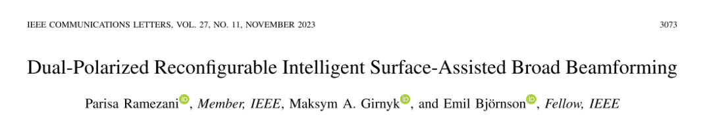
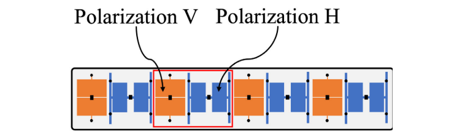
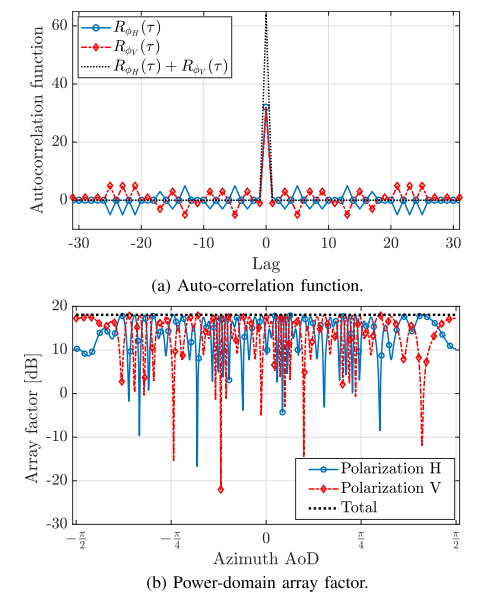
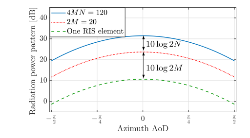
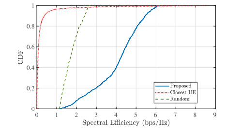
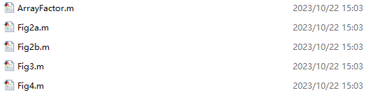
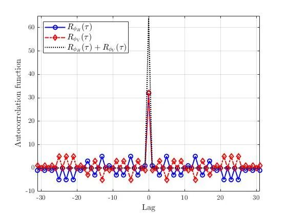
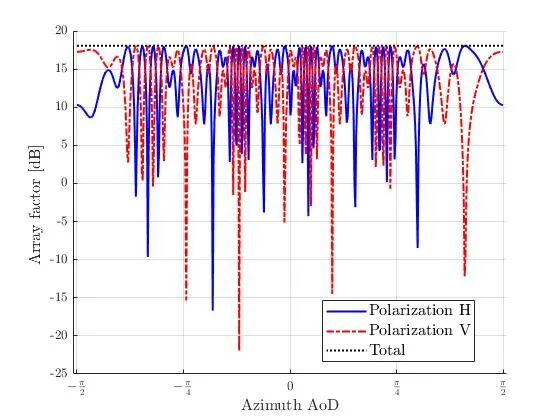
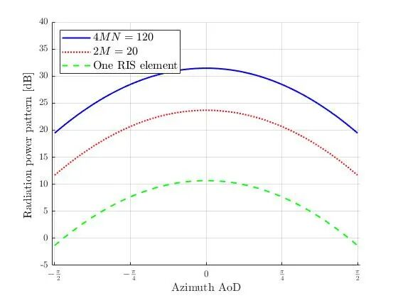
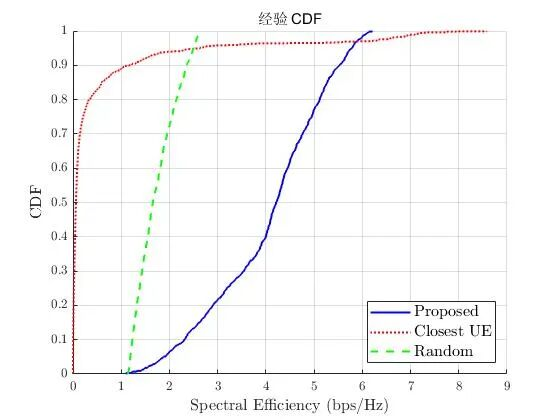

# Smart Ultra-Surface: Dual Polarization Reconfigurable Smart Surface for Bandwidth Beamforming [with MATLAB Code]

Introduction Reconfigurable intelligent surfaces (RIS) are metasurfaces controlled by software, composed of many passive elements (metaatoms), which produce controllable phase shifts to the incident signals and reflect them in a desired manner. Since their introduction, RIS has been extensively studied for various applications that improve wireless network performance, such as coverage expansion, rank improvement, and physical layer security enhancement.
Previous research on RIS-assisted communication focused on improving individual user performance by configuring RIS to maximize their rate through forming narrow beams directed towards them during data transmission [2] and [3]. Meanwhile, there are many real-world scenarios where public signals must be transmitted to multiple users located at wide angles and possibly unknown positions, for example, when base stations send cell-specific signals such as primary synchronization signal (PSS), secondary synchronization signal (SSS), or cell-specific reference signal (CRS) through RIS. In such cases, beam scanning methods can be employed where RIS forms narrow beams directed towards all directions.
This is an inefficient technique in terms of resource utilization. Another approach is to have RIS reflect signals as wide beams to uniformly cover large angle intervals. However, the beam width is inversely proportional to the RIS aperture size, so larger RISs produce narrower beams. Recently, [4] authors proposed a method for achieving quasi-static wide coverage in RIS-assisted systems by optimizing the base station precoding and RIS phase shifts to minimize the difference between predefined modes and RIS reflected power patterns. Their proposed scheme can partially widen the beams produced by RIS, but even within a limited target angle range, RIS exhibits fluctuations. The purpose of this letter is to design a method to generate uniform wide beams from RIS that can cover all angle directions around the surface.
The translation of the Chinese text into English is as follows:
Unless only one RIS element is activated, it is not possible to achieve an ideal wide beam in single-polarization transmission. Recently, bipolarization beamforming has been used in [5], [6], and [7] to utilize the polarization freedom of modern antennas, thus designing arbitrary wide beams from a bipolarization array. The basic idea behind this method is to design the weight values for the beamforming of the bipolarization antennas so that the beams of different polarization directions complement each other, forming a more extensive radiating beam. Inspiration from these works, this paper proposes the use of a bipolarization RIS composed of reflective elements with two orthogonal polarizations, and introduces a phase shift design that can realize wide beamforming from the RIS. 1) A phase shift for a bipolarization RIS was designed such that the wide beam reflected from the RIS covers all possible angle directions at which users may stay. This is achieved by making the RIS phase shift vector be a so-called Gray Complementary Sequence pair, which has its autocorrelation function (ACF) summed up to be the Kronecker Delta function. 2) We have proven that such sequence pairs can be used to construct large RIS configurations from smaller ones while maintaining the beam shape. 3) The final simulation results validate the effectiveness of the proposed scheme, indicating that it has better coverage than the RIS scheme for diffuse scattering.
Figure 1. A bipolarization RIS, where each hyperatom consists of two reflectors, which reflect signals with orthogonal polarizations, allowing independent modification of the phase of the collision waves. Details are provided in [8].
Figure 2. A plot showing the sum of the ACF and PDAF for a Gray Complementary pair of length M = 32.
Figure 3. Radiation power patterns and azimuth AoD.
Figure 4. CDF of spectral efficiency.
Conclusion: This letter studies a RIS-assisted communication scenario where the transmitter sends public signals to a large number of users with the help of a dual-polarization RIS. We propose a new wide beam design characterized by a spatially flat PDAF, making the RIS equally useful for all users located at any angle direction. Specifically, we demonstrate that to achieve a spatially flat PDAF, it is necessary to jointly design the phase shift in two polarizations of the RIS such that their ACF sum up to a Kronecker triangle. This unique property is due to a class of RIS configurations called Golay complementary sequences even. Therefore, by letting the RIS phase shift vectors form Golay pairs, the RIS can radiate wide beams and serve a large number of users simultaneously. We also propose an extension method for using Golay pairs in RIS, where the configuration designed for small RISes is extended to be used together with larger RISes while maintaining its beam shape.
MATLAB Code List
MATLAB Simulation Results

## Images

<!-- PAYMENT_BLOCK -->

## Get this dataset

- Payment link (Stripe): [Buy now](https://buy.stripe.com/3cs8yP7sY87d0vu9AB)
- Payment QR code: 

<!-- /PAYMENT_BLOCK -->
